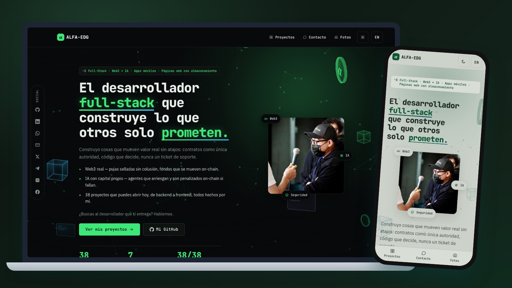
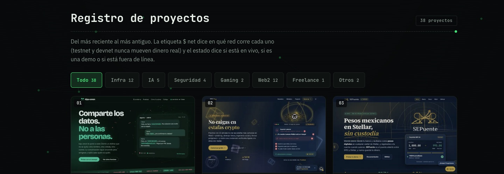
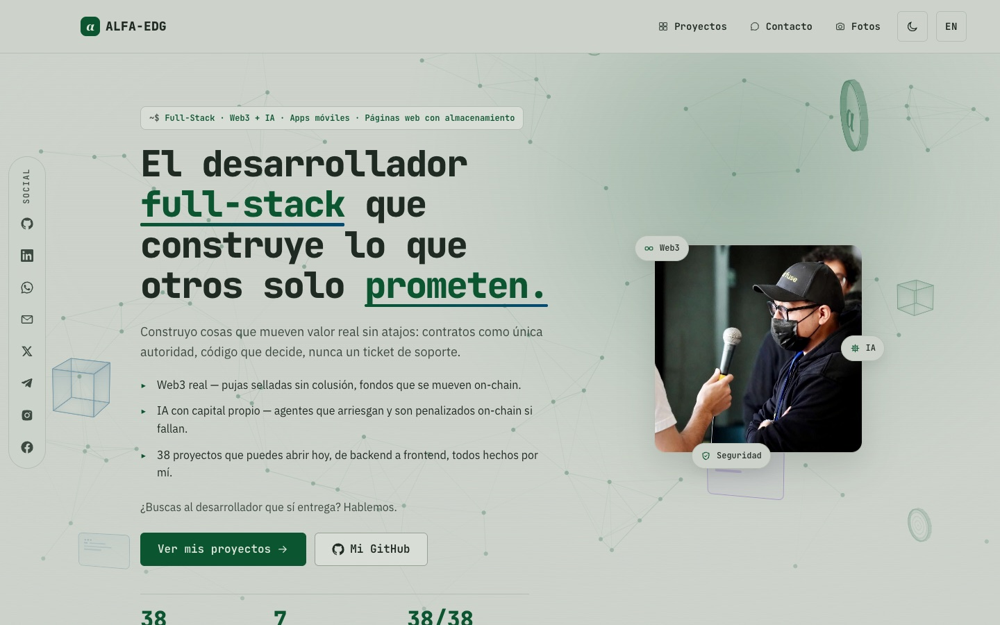
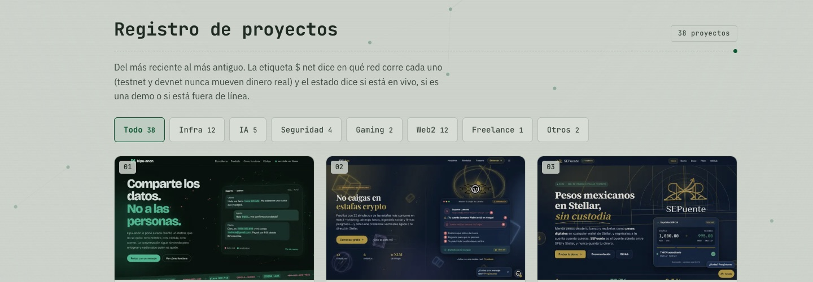
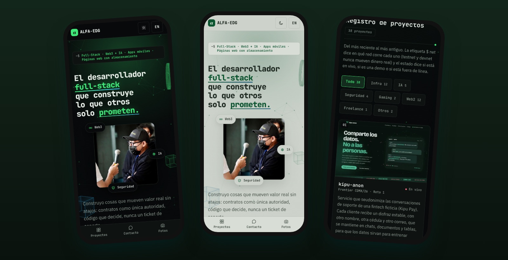
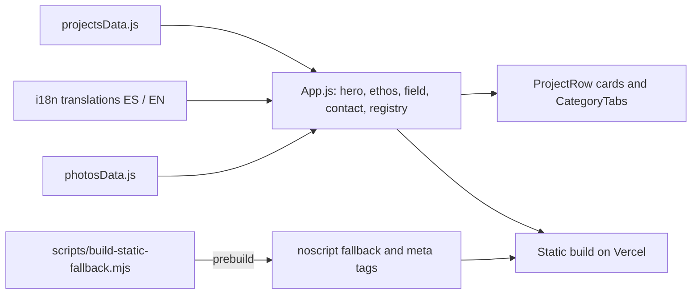

<div align="center">

# ALFA-EDG

### The full-stack developer who ships what others only pitch.

Personal portfolio of **ALFA** (Edgar) — Web3 + AI builder from Mexico. Every project in it opens at a live link.

[](https://alfaedg.vercel.app)
[](https://github.com/ALFA117)
[](LICENSE)


<br/>



**[▶ Open the site](https://alfaedg.vercel.app)** · **[Project registry](https://alfaedg.vercel.app/#proyectos)** · **[How it's built](#-how-its-built)** · **[Fix notes](docs/FIX_NOTES.md)**

</div>

---

## 🎯 What it is

A one-page, terminal-inspired showcase of everything I have built and deployed: Web3 protocols, AI agents, security tools, commercial Web2 demos and freelance work. It is bilingual (ES/EN), has a dimmed light theme and a dark theme, and runs fully in the browser with no backend.

The rule of the site is **honesty over hype**: every card says which network the project really runs on (`$ net Stellar testnet`, `Solana devnet`, `Demo · negocio ficticio`…) and whether it is live, a demo or offline. The hero shows the date of the last manual link check.

## 🗂️ The project registry

| Category | Projects | | Status | Projects |
|:--|:--:|:--|:--|:--:|
| Infra | 12 | | Live | 11 |
| Web2 (fictional-business demos) | 12 | | Demo | 24 |
| AI | 5 | | Offline | 3 |
| Security | 4 | | | |
| Gaming · Other | 2 · 2 | | | |
| Freelance | 1 | | **Total** | **38** |

<sub>Counted from <code>src/projectsData.js</code>. Last link check recorded there: 38/38 responding on 2026-11-07.</sub>

<div align="center">

</div>

## ✨ Highlights

<table>
<tr>
<td width="50%"><p align="center"><sub>Dimmed "terminal paper" light theme: no surface above ~90% lightness.</sub></p></td>
<td width="50%"><p align="center"><sub>The registry in light mode: category filters with counts and a real screenshot per project.</sub></p></td>
</tr>
</table>

<div align="center">

<br/><sub>On phones: one-row top bar, bottom tab bar, title before the photo, 44px touch targets.</sub>
</div>

- **Scramble title:** the headline decodes from random glyphs in ~1.4 s (mono font, no layout shift); the real text sits in an `sr-only` span.
- **CSS 3D background:** α coins, chain blocks and terminal cards over a Canvas 2D node network, with pointer and scroll parallax. Fewer objects on phones, paused on hidden tabs, static under `prefers-reduced-motion`.
- **"In the field" photo reel** from hackathons and work sessions.
- **No-JS fallback:** a prebuild script writes a `<noscript>` version with every project and the real project count in the meta tags.
- **Accessible by design:** body text 16px, nothing under 12px, every text/background pair ≥ 4.5:1 in both themes.

## 🧠 How it's built



```
src/
  App.js                   # page composition
  projectsData.js          # every project (name, url, tag, env, description, preview) + linkCheck
  photosData.js            # "in the field" photo set
  components/ui/           # Button, Input, Card, Skeleton, EmptyState, ErrorState, Toast, MiddleTruncate
  components/              # ProjectRow, PhotoReel, ParticleNetwork, ScrambleTitle, SocialRail, ...
  i18n/                    # LanguageContext + translations.js (es/en)
  hooks/useScrollSpy.js    # nav active-section tracking
scripts/
  build-static-fallback.mjs  # prebuild: no-JS fallback + real project count in meta tags
  convert-previews.mjs       # PNG screenshots -> 640x400 webp
```

## 🛠️ Stack

| Layer | Technology |
|:--|:--|
| UI | React 19 (Create React App), no router, single-page anchors |
| Motion | framer-motion 13 (springs, nav indicator via `layoutId`, theme-icon swap, photo reel) |
| Styles | Plain CSS with design tokens (`src/index.css`) + `src/App.css` + `components/ui/` — no Tailwind, no CSS-in-JS |
| Background | Canvas 2D particle network + CSS 3D objects |
| i18n | Lightweight React context (`i18n/LanguageContext.js`) |
| Tooling | sharp (preview conversion) · Vercel |

## 🚀 Run it locally

```bash
npm install
npm start          # dev server at localhost:3000
npm run build      # runs the prebuild script, then builds to /build
```

<details>
<summary><b>Adding a project</b></summary>

1. Add an entry at the **top** of `projects` in `src/projectsData.js` (newest first).
2. Add `env` only if you know the network for sure (`Stellar testnet`, `Solana devnet`, `Demo · negocio ficticio`…). No `env` is better than a guessed one.
3. Drop a real 1280×800 screenshot as `src/assets/previews/<slug>.png`, run `node scripts/convert-previews.mjs`, import the webp.
4. If you re-check every link, update `linkCheck` (date, ok, total) — it's shown in the hero as-is.

</details>

<details>
<summary><b>Deploy</b></summary>

Vercel, manual: `vercel --prod` from this folder (a git push does **not** deploy). It publishes to both Vercel projects linked to this folder; the canonical URL is `https://alfaedg.vercel.app/`.

</details>

## 📂 Docs

| Document | What's in it |
|:--|:--|
| [docs/FIX_NOTES.md](docs/FIX_NOTES.md) | Audit passes (mobile, type scale, light theme, socials, hero), design decisions and a 2-minute phone checklist |

## 📄 License

[MIT](LICENSE)

---

<div align="center">

**Live demos, not mockups.**

Made in Mexico by **ALFA** · [@ALFA117](https://github.com/ALFA117) · Instagram [@alfa_edg.mou](https://www.instagram.com/alfa_edg.mou/)

</div>
